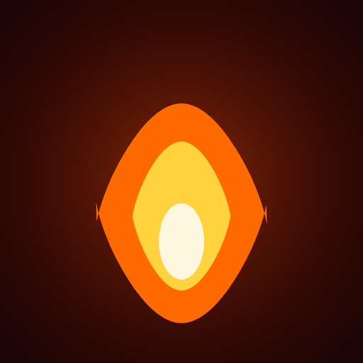

# Clash AI

### Une expérience photo de roast inspirée de la derja tunisienne

  

  <a href="https://clash-ai.pages.dev/">Clash AI</a> ·
  <a href="https://clash-ai.pages.dev/privacy.html">Confidentialité</a> ·
  <a href="https://github.com/anprogamernafti-boop/clash-ai">Code source</a>

Clash AI transforme une photo envoyée par l’utilisateur en verdict social amusant et en clash court, pensé pour le public tunisien. L’application privilégie la derja tunisienne et peut mêler des mots français ou anglais selon le contexte.

> **État du projet :** application web publiée et projet Android/Capacitor disponible. La synthèse vocale VoxCPM reste un pilote optionnel, soumis à l’activation du service et à son quota. La formulation en derja et la prononciation continuent d’être évaluées ; aucune précision parfaite n’est revendiquée.

## Fonctionnalités

- Analyse des éléments visibles liés au style, à la pose, à l’expression et à l’ambiance.
- Génération d’un verdict et d’un clash en derja tunisienne.
- Préparation de texte vocal avec écriture arabe vocalisée pour la derja et graphie d’origine pour les mots français et anglais.
- Création de cartes et de courtes vidéos partageables.
- Proxies serverless, limitation de débit et gestion des indisponibilités de services.
- Règles de sécurité : les plaisanteries visent le style et la pose, et les photos doivent être utilisées avec consentement.

## Architecture

**Flux principal :** Gemini via le Worker Cloudflare produit le verdict ; CLIP ViT-B/32 exécuté dans le navigateur sert de repli automatique. L’interface propose aussi OpenAI avec la clé API de l’utilisateur. Le texte parlé peut ensuite être envoyé au Worker VoxCPM facultatif ; l’application produit une carte ou une courte vidéo partageable.

| Couche | Technologies |
| --- | --- |
| Application web | HTML, CSS et JavaScript |
| Application Android | Capacitor 6, Android et Gradle |
| Vision principale | Gemini via Worker Cloudflare |
| Vision de secours dans le navigateur | Transformers.js et CLIP ViT-B/32 |
| Fournisseur facultatif | OpenAI via la clé API fournie par l’utilisateur |
| Synthèse vocale pilote | VoxCPM sur Hugging Face ZeroGPU via Worker Cloudflare |
| Hébergement et API | Cloudflare Pages, Workers et KV |

## Lancer le projet

Prérequis : Node.js 18 ou plus récent. Pour l’application Android, installe Android Studio, Android SDK et JDK 17 ou 21.

Installer les dépendances JavaScript et synchroniser le projet Android :

    npm ci
    npx cap sync android

Ouvre ensuite le dossier android dans Android Studio pour lancer l’application sur un émulateur ou un appareil connecté. Le dépôt fournit aussi build-debug.cmd pour créer un build de débogage sous Windows.

Pour afficher la version web sans les services Cloudflare :

    python -m http.server 8000 --directory www

Puis ouvre [http://localhost:8000](http://localhost:8000). Les fonctions IA nécessitent les Workers et secrets correspondants ; la voix dépend en plus de la disponibilité et du quota ZeroGPU.

## Déploiement et configuration

Les fichiers de configuration backend décrivent les Workers et leurs liaisons. Pour déployer dans un autre compte Cloudflare, crée d’abord les ressources KV et de limitation de débit, puis remplace leurs identifiants dans la configuration. Range les clés API et jetons dans les secrets Wrangler ; ne les ajoute jamais au code client ni au dépôt.

Les coordonnées de paiement externes ne sont volontairement pas publiées. Pour un déploiement dérivé, configure les contacts dans www/private-config.js à partir de l’exemple fourni.

## Confidentialité et utilisation responsable

Consulte la [notice de confidentialité](https://clash-ai.pages.dev/privacy.html) et les réglages des fournisseurs avant tout déploiement. N’utilise que des photos de personnes qui ont donné leur accord. Clash AI est un divertissement, pas un outil d’identification ; les clashs doivent porter sur le style, la pose et l’ambiance, jamais sur le corps, l’origine, la religion, le handicap ou la santé.

## À propos

Projet conçu par Asser Nafti, autour de la génération en derja, des applications web mobiles et de l’intégration d’API IA dans une architecture serverless.

**Made in Tunisia 🇹🇳**
