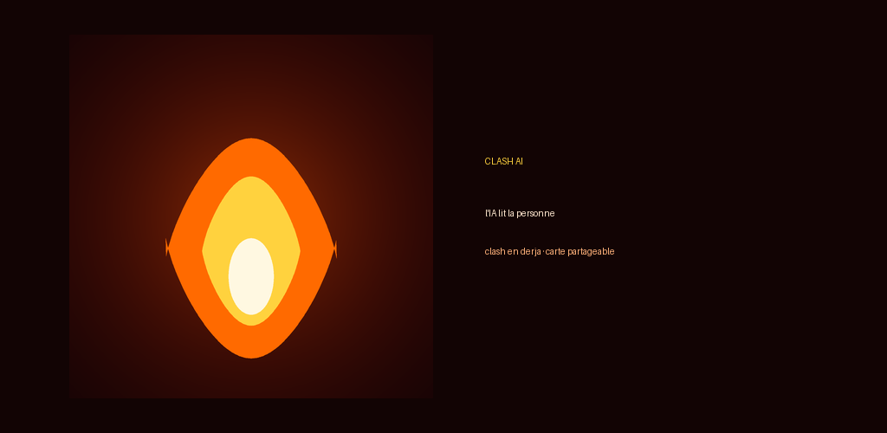
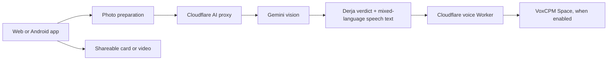

# 🇹🇳 Clash AI

### A photo-powered roast experience built around Tunisian Derja.

<p align="center">
  
</p>

<p align="center">
  <a href="https://clash-ai.pages.dev/">Live demo</a> ·
  <a href="https://clash-ai.pages.dev/privacy.html">Privacy notice</a>
</p>

Clash AI turns a consenting user's photo into a playful social-style verdict and a short, shareable roast. The product is designed for Tunisian users: the main language is Derja, with natural French and English code-switching where it fits.

> **Project status:** public web app and Android/Capacitor source, with serverless Cloudflare services. Voice generation is an optional, quota-dependent pilot. AI wording and pronunciation are still reviewed iteratively; this project does not claim perfect dialect accuracy.

## What it does

- Analyzes visible style, pose, expression and setting.
- Generates a short, playful Tunisian Derja roast with language-specific spelling rules.
- Prepares spoken text with Derja in vocalized Arabic, French in French spelling, and English-only words in English spelling.
- Produces shareable verdict cards and short videos.
- Includes privacy-minded serverless proxies, optional voice synthesis, rate limits and user-facing error handling.
- Keeps jokes focused on style and presentation, not body or sensitive traits; asks users to submit photos with consent.

## Product preview

Try the [live web demo](https://clash-ai.pages.dev/). Availability of AI and voice features can depend on service configuration, rollout and provider quota.

## How it is built



| Layer | Technology |
|---|---|
| Web app | HTML, CSS, JavaScript |
| Android app | Capacitor, Android native plugins, Gradle |
| AI generation | Gemini through a Cloudflare Worker proxy; OpenAI-compatible path is also present in the client |
| Voice pilot | VoxCPM hosted on Hugging Face ZeroGPU, reached through a protected Cloudflare Worker |
| Hosting and serverless APIs | Cloudflare Pages, Workers and KV |

## Repository map

```text
www/                         Web application, assets and privacy page
android/                     Capacitor Android project and native plugins
backend/gemini/               Gemini proxy Worker
backend/voice/                Voice Worker, pilot tools and quality controls
backend/events/               Aggregate event-count Worker
backend/referral/             Referral Worker
backend/activation/           Activation-code Worker
```

## Run locally

Requirements: Node.js 18+, Android Studio, Android SDK and JDK 17 or 21 for Android builds.

```bash
npm ci
npm test
npx cap sync android
```

Open `android/` in Android Studio to run on an emulator or device. On Windows, `build-debug.cmd` is provided for a debug build. Configure the Android SDK locally; generated SDK paths and signing credentials are intentionally excluded from Git.

Optional external-payment contacts are intentionally kept out of the public repository. Copy `www/private-config.example.js` to `www/private-config.js` and fill in contacts you control; the real config file is ignored by Git. Without it, external payment options stay hidden.

To preview the web app, serve `www/` with a local static server. Cloudflare-backed AI features require the corresponding Workers and secrets to be configured in an account you control.

## Cloud deployment notes

The `backend/*/wrangler.toml` files describe the Workers and bindings. Before deploying into another Cloudflare account, replace account-specific KV and rate-limit identifiers with resources created in that account. Put API keys and operator tokens in Wrangler secrets; **never** put them in client code, committed configuration, screenshots or issue reports.

The Hugging Face voice Space and ZeroGPU have their own availability and usage limits. The app can remain usable for text and sharing when voice is unavailable.

## Privacy and responsible use

Photos are submitted by the user for analysis. Use only photos of people who have agreed to participate. The app is entertainment, not a face-recognition or identity tool. Roasts should target styling, pose and vibe, never a person's body, origin, religion, disability or health.

Review the [privacy notice](https://clash-ai.pages.dev/privacy.html) before deployment. Replace the support-contact placeholders in the source with a public support address that you control. Review the data flows and third-party provider settings for your own deployment.

## About this portfolio project

Clash AI is a product and engineering project focused on a specific language and audience. It brings together mobile-web delivery, image-to-text generation, Tunisian Derja prompt design, mixed-language speech preparation, serverless APIs, Android sharing and iterative user feedback.

**Built in Tunisia 🇹🇳**
